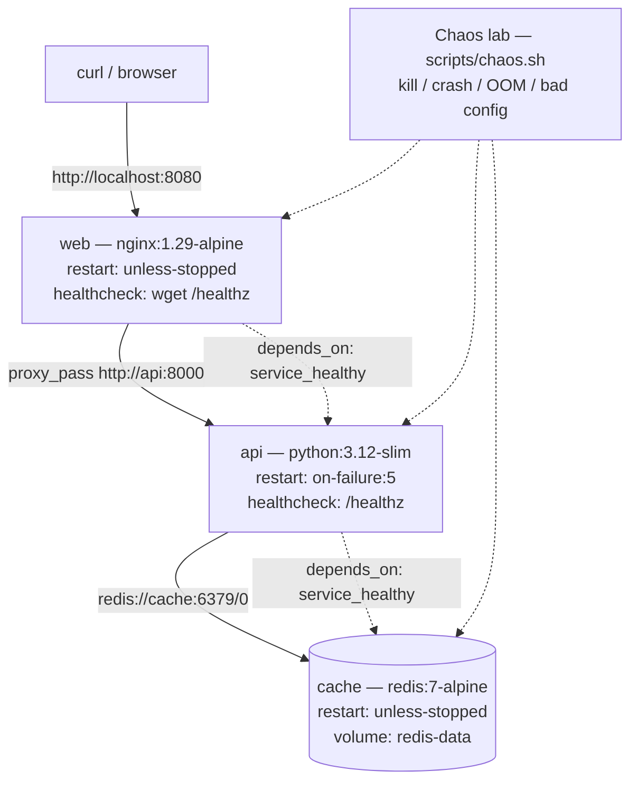
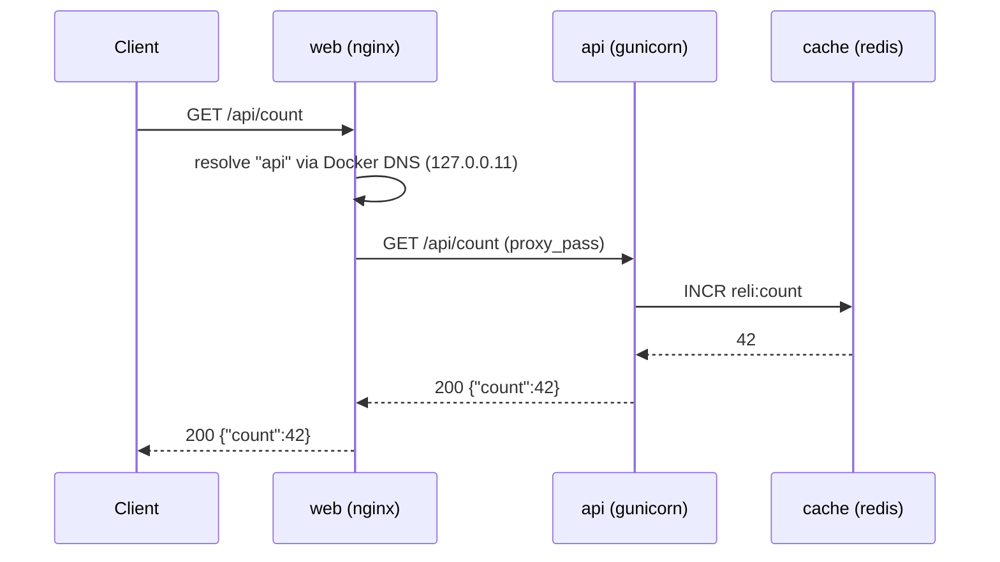

# ReliStack

**A self-healing Docker Compose stack with a built-in chaos lab.**

ReliStack is a three-service stack — NGINX reverse proxy → Flask API → Redis
cache — engineered so that every container has a healthcheck, an explicit
restart policy, and a documented failure mode. Eight reproducible experiments
break the stack on purpose and record what Docker actually does.

The project exists to make container lifecycle behaviour *observable* rather
than theoretical: you do not read about exit code 137, you watch a container
get OOM-killed and then read the `docker inspect` output.

---

## What this demonstrates

| Concept | Where it lives | Proof |
|---|---|---|
| Container lifecycle: start / stop / kill / restart | `docker-compose.yml`, `scripts/chaos.sh` | [E1](docs/05-experiments.md#e1--stop-vs-kill) |
| Restart policies and their real semantics | `restart:` per service | [E2](docs/05-experiments.md#e2--the-restart-policy-matrix), [E3](docs/05-experiments.md#e3--retry-exhaustion-on-failure5) |
| Automatic container restart | `on-failure:5` on the API | [E3](docs/05-experiments.md#e3--retry-exhaustion-on-failure5) |
| `stop` vs `kill`: SIGTERM vs SIGKILL | `scripts/chaos.sh stop-api\|kill-api` | [E1](docs/05-experiments.md#e1--stop-vs-kill) |
| Healthchecks and health-gated startup | `depends_on: condition: service_healthy` | [E6](docs/05-experiments.md#e6--dependency-ordering) |
| Exit codes and what they mean | exit 0 / 1 / 137 | [E1](docs/05-experiments.md#e1--stop-vs-kill), [E4](docs/05-experiments.md#e4--oom-kill) |
| Memory limits and the OOM killer | `deploy.resources.limits.memory` | [E4](docs/05-experiments.md#e4--oom-kill) |
| Volumes and persistence | `redis-data` named volume | [E7](docs/05-experiments.md#e7--data-persistence) |
| Graceful reload vs hard restart | `nginx -s reload` | [E8](docs/05-experiments.md#e8--graceful-reload-vs-hard-restart) |
| Build context, layer caching, multi-stage builds | `api/Dockerfile`, `web/Dockerfile` | [docs/03](docs/03-build-and-run.md) |

---

## Architecture



### Request flow



If the API is down, the proxy answers **502** (no live upstreams) or **504**
(connect timeout) — the failure is visible to the client, not swallowed.

### Service matrix

| Service | Image | Port | Restart policy | Healthcheck | Purpose |
|---|---|---|---|---|---|
| `web` | `nginx:1.29-alpine` | `8080:8080` | `unless-stopped` | `wget /healthz` | Reverse proxy + static page |
| `api` | `python:3.12-slim` | internal `8000` | `on-failure:5` | `GET /healthz` | Flask app (gunicorn) |
| `cache` | `redis:7-alpine` | internal `6379` | `unless-stopped` | `redis-cli ping` | Counter store on a volume |

**Why these policies** (full reasoning in [docs/02](docs/02-docker-concepts.md)):

- `web` = `unless-stopped` — it is the front door and should return after a
  host reboot, but an explicit `docker compose stop` must keep it down. An
  operator stopping the stack on purpose should not have it fight back.
- `api` = `on-failure:5` — a crash is worth retrying, but an infinite crash
  loop is a worse outage than a visible, stopped service. Five retries, then
  Docker gives up and the container stays `exited` where you can see it.
- `cache` = `unless-stopped` — same reasoning as the proxy; Redis restarts
  cleanly and the counter is not critical path data.

---

## Quick start

**Prerequisites:** Docker Engine 20.10+ with the Compose plugin (v2+), and
about 500 MB of free disk for the images.

```bash
# 1. Build the images and start the stack in the background.
#    -d = detached, so your terminal stays free.
#    --build = force a rebuild of the two local images.
docker compose up -d --build

# 2. Check the state. Every service should read "healthy".
docker compose ps

# 3. Verify the request path end to end.
curl -s http://localhost:8080/healthz      # -> ok
curl -s http://localhost:8080/api/hello    # -> {"message":"hello from reli-api","container":"..."}
curl -s http://localhost:8080/api/count    # -> {"count":1,...}

# 4. Run the automated checks.
./scripts/smoke-test.sh                     # -> 5 passed, 0 failed
```

Open <http://localhost:8080> for the landing page, which probes all three
services live in the browser.

### Daily commands

```bash
docker compose ps                  # status of every service
docker compose logs -f api         # follow one service's logs
docker compose restart api         # restart one service
docker compose stop                # stop everything (containers kept)
docker compose up -d               # start it again
docker compose down                # remove containers + network (volume kept)
docker compose down -v             # ALSO remove the volume -> data is gone
docker compose exec api sh         # shell inside the running API container
./scripts/check-lifecycle.sh       # exit codes, OOM flags, restart counts
```

---

## Running the chaos lab

Each experiment is a script that prints a hypothesis, performs the failure,
and records the real output. Nothing is faked.

```bash
# Run one experiment and save its output under docs/results/
./scripts/capture.sh E1-stop-vs-kill "./scripts/experiments/e1-stop-vs-kill.sh"

# Or drive the stack interactively
./scripts/chaos.sh status
./scripts/chaos.sh kill-api        # SIGKILL the API
./scripts/chaos.sh crash-api       # crash-loop it
./scripts/chaos.sh bad-config      # break nginx.conf
./scripts/chaos.sh recover         # bring everything back to green
```

| ID | Experiment | Script |
|---|---|---|
| E1 | `stop` vs `kill` — SIGTERM vs SIGKILL | `scripts/experiments/e1-stop-vs-kill.sh` |
| E2 | Restart-policy matrix | `scripts/experiments/e2-restart-matrix.sh` |
| E2b | Why no policy revived a killed container | `scripts/experiments/e2b-why-no-restart.sh` |
| E2c | `docker events` ground truth | `scripts/experiments/e2c-events-trace.sh` |
| E3 | Retry exhaustion with `on-failure:5` | `scripts/experiments/e3-retry-exhaustion.sh` |
| E4 | OOM kill — exit 137 | `scripts/experiments/e4-oom-kill.sh` |
| E5 | Broken NGINX configuration | `scripts/experiments/e5-broken-config.sh` |
| E6 | `service_started` vs `service_healthy` | `scripts/experiments/e6-dependency-ordering.sh` |
| E7 | Volume persistence across `down` / `down -v` | `scripts/experiments/e7-persistence.sh` |
| E8 | Graceful reload vs hard restart | `scripts/experiments/e8-reload-vs-restart.sh` |

---

## Results at a glance

All numbers below are verbatim from the captures in
[`docs/results/`](docs/results/) — see
[`experiments/RESULTS.md`](experiments/RESULTS.md) for the full write-up.

| Finding | Evidence |
|---|---|
| SIGTERM → exit 0, SIGKILL → exit 137 | E1 |
| `docker kill` does **not** revive a container under *any* policy, including `always` | E2, E2b |
| A natural death **does** revive it — the event stream shows `die`→`start` vs `kill`→`die` | E2b, E2c |
| `on-failure:5` stops at exactly 5 restarts, then the container stays `exited` | E3 |
| An OOM kill gives exit 137 + `OOMKilled=true`, and *does* trigger the policy | E4 |
| The OOM killer kills a process — the container survives if only a child died | E4 |
| `service_started` produced 3 × HTTP 503; `service_healthy` produced 0 | E6 |
| The counter survived `down` (37 → 38) and reset after `down -v` (→ 1) | E7 |
| A graceful reload dropped 0 of 751 requests; a hard restart dropped 16 of 838 | E8 |
| Smoke test: 5 passed, 0 failed | [docs/06](docs/06-testing.md) |

**Two of my original predictions were wrong**, and the corrected findings are
the most valuable part of the project — see
[docs/08-lessons-learned.md](docs/08-lessons-learned.md).

---

## Repository layout

```
.
├── docker-compose.yml        # the three services, their policies and probes
├── api/
│   ├── Dockerfile            # single-stage, non-root, image-level HEALTHCHECK
│   ├── app.py                # Flask: /healthz, /api/hello, /api/count
│   └── requirements.txt
├── web/
│   ├── Dockerfile            # nginx + fail-fast entrypoint
│   ├── nginx.conf            # upstream with resolve, keepalive, /healthz
│   ├── relistack-entrypoint.sh
│   └── static/index.html     # landing page with live status badges
├── scripts/
│   ├── smoke-test.sh         # 5 automated assertions
│   ├── chaos.sh              # interactive failure injector
│   ├── check-lifecycle.sh    # exit code / OOM / restart-count probe
│   ├── capture.sh            # saves real output to docs/results/
│   └── experiments/          # E1 .. E8, one script each
├── docs/                     # 8 chapters + real captured output
└── experiments/RESULTS.md    # hypothesis → command → observed → conclusion
```

---

## Documentation

| Chapter | Contents |
|---|---|
| [01 — Architecture](docs/01-architecture.md) | Services, network, data flow, and why each piece exists |
| [02 — Docker concepts](docs/02-docker-concepts.md) | Images vs containers, layers, volumes, networks, healthchecks, restart policies, exit codes, limits |
| [03 — Build and run](docs/03-build-and-run.md) | Every Dockerfile instruction, layer caching, `compose up`, logs, `exec` vs `run` |
| [04 — Lifecycle and restart](docs/04-lifecycle-and-restart.md) | create/start/stop/kill/restart, signals, grace period, the four policies, `docker update` |
| [05 — Experiments](docs/05-experiments.md) | E1–E8 with real captured output and conclusions |
| [06 — Testing](docs/06-testing.md) | The smoke test, what each assertion proves, how to add one |
| [07 — Troubleshooting](docs/07-troubleshooting.md) | Symptom → cause → fix, including the errors hit while building this |
| [08 — Lessons learned](docs/08-lessons-learned.md) | The mental models, the corrections, and what I would do differently |

---

## Troubleshooting quick reference

| Symptom | Likely cause | Fix |
|---|---|---|
| Container exits immediately | Bad config or bad command | `docker compose logs --tail=50 <svc>` |
| `unable to find user appuser` | Base image has no such user | Create the user in the Dockerfile (see [docs/03](docs/03-build-and-run.md)) |
| `502` from the proxy | The API is down | `docker compose ps api` |
| `504` from the proxy | The API is unreachable / timing out | Check the API's health and `proxy_connect_timeout` |
| `503` from `/api/count` | Redis is unreachable | `docker compose ps cache` |
| `port is already allocated` | Something else owns 8080 | `docker ps` then change the host port |
| Container restarting in a loop | Crash or bad config | `docker inspect --format '{{.State.ExitCode}}' <c>` |
| Exit code 137 | SIGKILL — OOM or `docker kill` | `docker inspect --format '{{.State.OOMKilled}}' <c>` |

Full table with real error text: [docs/07-troubleshooting.md](docs/07-troubleshooting.md).

---

## Design decisions worth defending

1. **NGINX in front of the API.** It creates a second, independent failure
   surface and it is the only service exposed to the host.
2. **`depends_on: condition: service_healthy` everywhere.** Measured: it
   removes all startup 503s (E6).
3. **`on-failure:5` for the API, `unless-stopped` for the proxy.** A bounded
   retry budget beats an infinite loop; a manually stopped proxy stays
   stopped.
4. **`/healthz` on the API deliberately does not touch Redis.** Otherwise a
   cache outage would mark the API unhealthy, and Compose would never let it
   start even though it could still serve everything else.
5. **A fail-fast NGINX entrypoint.** `nginx -t` before `exec` turns a silent
   crash loop into one readable error line (E5).
6. **Single-stage API image.** Nothing to compile, so a builder stage would
   only add layers.
7. **Real captured output in the docs.** The first-run captures are kept in
   `docs/results/first-run-errors/` rather than deleted, so the corrections
   stay auditable.

---

## License

MIT — see [LICENSE](LICENSE).
