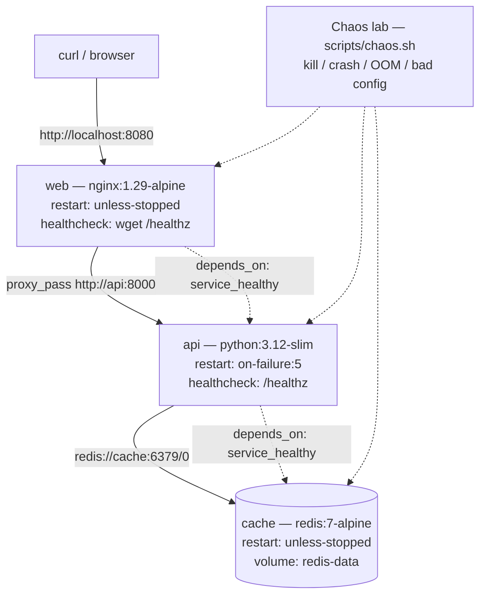
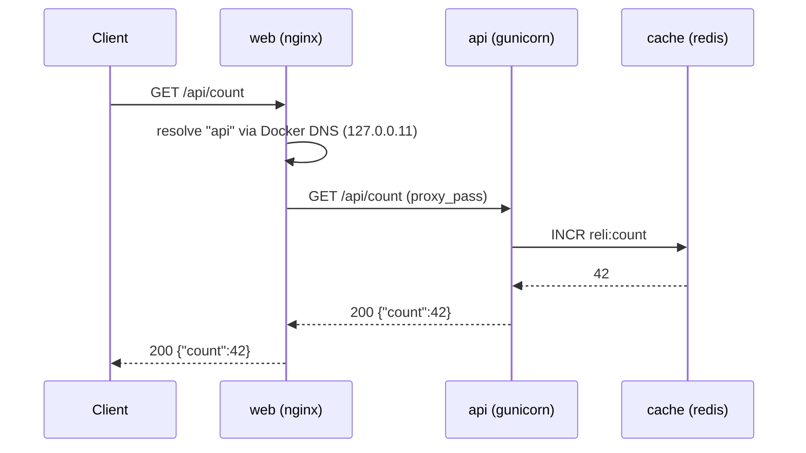

# 01 — Architecture

> **What this chapter covers:** the three services, the network between them,
> the data flow, and the reasoning behind each structural decision.

---

## 1. The shape of the stack

ReliStack is a classic three-tier web application, deliberately kept small
enough to reason about end to end:



Three containers, one Docker network, one published port, one volume.

| Service | Image | Role | Exposed to host? |
|---|---|---|---|
| `web` | `nginx:1.29-alpine` | Reverse proxy, static landing page | Yes — `8080:8080` |
| `api` | `python:3.12-slim` | Flask application server (gunicorn) | No — `expose` only |
| `cache` | `redis:7-alpine` | Counter store | No — `expose` only |

---

## 2. The request path



Step by step:

1. The client resolves `localhost:8080` and connects. Docker's port
   publishing forwards that connection into the `web` container's port 8080.
2. NGINX matches `location /api/` and forwards to the upstream named
   `reli_api`, which contains the server `api:8000`.
3. The name `api` is resolved by Docker's **embedded DNS server** at
   `127.0.0.11`, which runs on every user-defined network. Compose registers
   each service name as a network alias.
4. The Flask app increments the Redis key `reli:count` and returns JSON.
5. The JSON travels back through the proxy to the client.

### Why the proxy references `api:8000` and not an IP

Docker assigns container IPs dynamically. A container that is recreated gets
a **new IP address**. If `nginx.conf` contained `proxy_pass http://172.18.0.3:8000`,
the proxy would keep dialling the old address forever and return 502 after
the API was replaced.

Using the service name means Docker's DNS resolves it fresh. The upstream
block additionally uses `resolve` so nginx re-resolves the name instead of
pinning the address it saw at startup:

```nginx
upstream reli_api {
    zone reli_api 64k;
    server api:8000 resolve;
    keepalive 16;
}
```

`zone` is mandatory when `resolve` is used — nginx needs a shared memory zone
to store the resolved addresses.

---

## 3. The three decisions that shaped the stack

### Decision 1 — NGINX in front of the API

**Why.** A reverse proxy is the standard shape for a containerised web app,
and it buys two things that matter for this project:

- **One entry point.** Only the proxy is published to the host. The API and
  the cache stay on the internal network, which is what you would do in
  production.
- **Two independent failure surfaces.** When the API is killed, the proxy
  stays up and translates the failure into a 502 for the client. When the
  proxy is killed, everything is unreachable. Two different symptoms, two
  different diagnoses — far better for learning than a single monolithic
  container.

**Cost.** One extra hop and one more thing to configure. Worth it here.

### Decision 2 — `depends_on: condition: service_healthy`

**Why.** Plain `depends_on` only waits for the dependency's **container** to
be created. It does not wait for the service to be *ready*. A container that
has been created but whose process is still booting will receive traffic it
cannot yet serve.

Experiment E6 measures the difference with a Redis that takes 8 seconds to
start:

| Condition | Failed requests during startup |
|---|---|
| `service_started` | **3 × HTTP 503** |
| `service_healthy` | **0** |

**Cost.** The stack starts slower, because Compose genuinely waits for
readiness. That is the trade you want.

### Decision 3 — A named volume, and only for Redis

**Why.** Only one service holds state. Giving it a named volume (rather than
a bind mount) means Docker manages the storage, the path does not leak host
layout into the project, and the volume has a stable name independent of any
container.

Experiment E7 verifies both halves of the lifecycle:

| Action | Volume | Counter |
|---|---|---|
| `docker compose down` | kept | 37 → **38** (survives) |
| `docker compose down -v` | **deleted** | → **1** (reset) |

---

## 4. Network topology

Compose creates one user-defined bridge network, `relistack-relinet`:

```bash
docker network inspect relistack-relinet
```

A user-defined network gives three things a default bridge does not:

1. **Automatic DNS.** Containers resolve each other by service name.
2. **Isolation.** Only containers on this network can reach each other.
   Nothing else on the host can reach the API or Redis ports.
3. **Stability.** The network persists across `docker compose down`/`up`
   as long as it is not removed with `-v`.

The API and cache use `expose` rather than `ports`. `expose` documents the
port for humans and for other containers on the network, but **does not
publish it to the host** — only `ports` does that.

---

## 5. Healthcheck design

Each service answers a probe that reflects *its own* job, and — critically —
does not depend on anything it might merely be a client of.

| Service | Probe | Depends on Redis? |
|---|---|---|
| `web` | `wget -qO- http://127.0.0.1:8080/healthz` | **No** |
| `api` | `GET http://127.0.0.1:8000/healthz` | **No** |
| `cache` | `redis-cli ping` | — |

**Why the API's `/healthz` must not touch Redis.** If the healthcheck queried
Redis, a cache outage would mark the API unhealthy. Compose would then never
start the proxy (`depends_on: service_healthy`), and the API would be pulled
out of rotation — even though it can still serve `/api/hello` perfectly well.
A healthcheck should answer *"is this process able to do its job?"*, not
*"is the whole world healthy?"*.

**Why the proxy's `/healthz` must not touch the API.** Same logic in the
other direction: while the API is down, the proxy is still doing its job
(accepting connections and reporting the failure as a 502). If the proxy's
health depended on the API, the proxy would look unhealthy during an API
outage and you would lose the diagnostic signal.

This is why the API is deliberately split into two failure surfaces:

| Situation | `/healthz` on proxy | `/api/hello` | Diagnosis |
|---|---|---|---|
| Everything fine | 200 | 200 | — |
| API down | **200** | **502** | API problem |
| Proxy down | **no response** | no response | Proxy problem |

---

## 6. What is deliberately not here

| Excluded | Why |
|---|---|
| TLS / certificates | Adds a whole certificate lifecycle to a project about lifecycle |
| Horizontal scaling | Upstream + DNS re-resolution on scale is a topic of its own |
| Kubernetes | Different world; the Compose concepts transfer, the commands do not |
| Prometheus / Grafana | A metrics pipeline is a separate project |
| Authentication | Irrelevant to the Docker behaviour being studied |
| Multiple database replicas | Redis with a volume is enough to teach persistence |

The scope rule for the 5-hour budget was: if the stack was not fully green
by the 2-hour mark, drop Redis. It was green well before that, so nothing
was cut.

---

## 7. Startup order, observed

The `docker compose up -d` output shows the health-gating working:

```
 Container relistack-cache Creating
 Container relistack-cache Created
 Container relistack-api Creating
 Container relistack-api Created
 Container relistack-cache Starting
 Container relistack-cache Started
 Container relistack-cache Waiting
 Container relistack-cache Healthy        <-- wait ends here
 Container relistack-api Starting
 Container relistack-api Started
 Container relistack-api Waiting
 Container relistack-api Healthy          <-- wait ends here
 Container relistack-web Starting
 Container relistack-web Started
```

The `Waiting` → `Healthy` pairs are Compose blocking until each dependency
has actually passed its healthcheck. Read it as: *the cache became healthy
before the API was allowed to start, and the API became healthy before the
proxy was allowed to start.*

---

**Next:** [02 — Docker concepts](02-docker-concepts.md) — the primitives this
architecture is built from.
