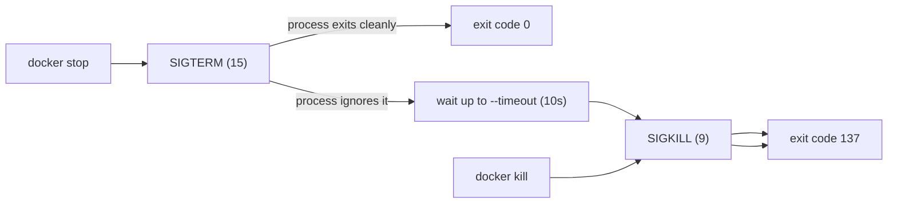

# 04 — Lifecycle and restart

> **What this chapter covers:** the container lifecycle, the difference between
> `stop` and `kill`, signals and the grace period, exit codes, and exactly
> when each restart policy fires.

---

## 1. The lifecycle commands

```bash
docker create <image>     # create without starting
docker start <container>  # start an existing container
docker run <image>        # create + start in one step
docker stop <container>   # SIGTERM, wait, then SIGKILL
docker kill <container>   # SIGKILL immediately
docker restart <container> # stop + start
docker pause / unpause    # freeze and thaw
docker rm <container>     # delete the container
```

**What each does.** `create` builds the container's filesystem and metadata
but leaves it stopped. `start` runs it. `run` does both. `stop` asks the
process to shut down. `kill` removes it without asking. `restart` is
`stop` followed by `start`. `pause` freezes the processes with a freezer
cgroup — the container still "exists" and still shows as running, but nothing
executes.

**Why it matters.** The distinction between `stop` and `kill` is the single
most useful thing in this chapter, and it is the one most often described
incorrectly.

**Expected output (real, from E1):**

```
### A) docker compose stop api   (SIGTERM, graceful)
 Container relistack-api Stopping 
 Container relistack-api Stopped 
exited exit=0 oom=false restarts=0 error=

### C) docker kill relistack-api   (SIGKILL, forced)
relistack-api
exited exit=137 oom=false restarts=0 error=
```

---

## 2. `stop` vs `kill` — SIGTERM vs SIGKILL

**What it does.**

- `docker stop` sends **SIGTERM** (signal 15) — a *request* to terminate.
  The process may catch it, stop accepting new work, finish what it is doing
  and exit cleanly. Docker waits up to the grace period (10 s by default) and
  then sends SIGKILL if the process is still alive.
- `docker kill` sends **SIGKILL** (signal 9) — an *order* that cannot be
  caught, blocked or ignored. The process is gone immediately.

**Why we need it.** A graceful stop lets an application finish in-flight
requests. A forced kill does not: connections are severed mid-flight and the
client sees a dropped connection.

**How it works.**



**Expected output.** The exit codes differ, and so does the proxy's response:

| Action | Exit code | `OOMKilled` | Proxy response |
|---|---|---|---|
| `docker compose stop api` | **0** | false | **504** |
| `docker kill relistack-api` | **137** | false | **502** |

**What we observed.** E1 produced exactly that. The proxy's two different
codes come from the nginx error log:

```
[error] upstream timed out (110: Operation timed out) while connecting to upstream, ... upstream: "http://172.18.0.3:8000/api/hello"
[error] no live upstreams while connecting to upstream, ... upstream: "http://reli_api/api/hello"
```

* **504** — nginx still had the API's IP in its pool and tried to connect;
  the TCP connect timed out (`proxy_connect_timeout 2s`).
* **502** — the pool had no live members left, so nginx answered immediately.

**Common mistakes.** Assuming `docker stop` always yields exit 0. If the
process ignores SIGTERM, Docker escalates to SIGKILL after the grace period
and you get **143** (or 137) instead. Assuming a 502 always means the app is
broken — it can also mean nginx simply could not open a socket.

### The grace period

```bash
docker stop --time 30 relistack-api     # wait up to 30s before SIGKILL
docker compose stop --timeout 30 api
```

The default is 10 seconds. Raise it for slow shutdowns; lower it for
deployments where you would rather cut over quickly.

---

## 3. Exit codes

**What they are.** The number a process returns to the operating system when
it finishes. Docker stores it in `.State.ExitCode`.

**Why they matter.** They are the cheapest, most reliable diagnosis tool in
Docker. "The container stopped" tells you nothing; "exit 137 with
OOMKilled=true" tells you the kernel killed it for using too much memory.

**The rule.** For a process killed by a signal, the shell-style convention is
**128 + signal number**:

| Signal | Number | Exit code | Produced by |
|---|---|---|---|
| SIGTERM | 15 | **143** | `docker stop` when SIGTERM is not handled |
| SIGKILL | 9 | **137** | `docker kill`, the OOM killer |

**What we observed.** Across the whole project:

| Scenario | Exit code | `OOMKilled` | Source |
|---|---|---|---|
| `docker compose stop api` | 0 | false | E1 |
| `docker kill relistack-api` | 137 | false | E1 |
| Broken NGINX config | 1 | false | E5 |
| Crashing API (E3) | 1 | false | E3 |
| OOM kill, PID 1 victim | 137 | **true** | E4 |

**Common mistake.** Treating 137 as "OOM". `docker kill` produces the same
137. The only way to tell them apart is `.State.OOMKilled`:

```bash
docker inspect --format '{{.State.ExitCode}} {{.State.OOMKilled}}' <container>
```

That is exactly the format `scripts/check-lifecycle.sh` uses.

---

## 4. The restart policies — and when they actually fire

**What they are.** A rule telling Docker whether to restart a container
after it exits.

**The four policies.**

| Policy | Restarts when | After `docker stop` | After a host reboot |
|---|---|---|---|
| `no` | never | no | no |
| `on-failure[:N]` | exit code ≠ 0 | no | only if it failed |
| `always` | always | **no** | yes |
| `unless-stopped` | always | **no** | yes, unless manually stopped |

**The rule everyone gets wrong.** **A restart policy does not fire when a
human stops the container.** Docker records such a stop as *manual* and
suppresses the policy. This applies to `docker stop`, `docker compose stop`
and `docker kill` alike.

**How it works.** The daemon watches for a container exit. It then asks: was
this exit operator-initiated? If yes → leave it alone. If no → consult the
policy.

**Expected output.**

```bash
$ docker inspect --format '{{.HostConfig.RestartPolicy.Name}}' relistack-api
on-failure
```

**What we observed — the key experiment.** E2 tested all four policies
against `docker kill`. Every one of them left the container dead:

```
### policy: no
after kill: exited exit=137 restarts=0
### policy: on-failure
after kill: exited exit=137 restarts=0
### policy: always
after kill: exited exit=137 restarts=0
### policy: unless-stopped
after kill: exited exit=137 restarts=0
```

That contradicted the expectation, so E2b varied *how* the container died
while holding the policy fixed at `always`:

```
### A) process exits by itself with code 1
before:  status=restarting exit=1 restarts=5 policy=always
after:   status=restarting exit=1 restarts=7 policy=always     <-- policy acted

### D) docker kill from OUTSIDE
before:  status=running exit=0 restarts=0 policy=always
after:   status=exited exit=137 restarts=0 policy=always        <-- policy suppressed
```

**E2c then proved the mechanism with `docker events`:**

```
# A) process exits by itself (exit 1), policy=always
1794412734 die
1794412734 start
1794412734 die
1794412734 start
                                    <-- die -> start: the policy acts

# B) docker kill from outside, policy=always
1794412752 kill
1794412752 die
                                    <-- kill -> die: no start, policy suppressed

# C) docker stop from outside, policy=always
1794412768 kill
1794412778 kill
1794412778 stop
1794412778 die
                                    <-- a stop event is recorded too
```

**The `kill` event is the marker.** When the daemon logs it, the stop was
operator-initiated and the policy is suppressed.

### The practical consequence

| Failure mode | Policy fires? |
|---|---|
| Process crashes on its own | **Yes** |
| OOM kill by the kernel | **Yes** (E4) |
| `docker stop` / `docker compose stop` | No — by design |
| `docker kill` | No — treated as an operator stop |
| Host reboot | Yes, for `always` / `unless-stopped` |

So a restart policy protects you against *crashes*, not against *operators*.
If you want the stack back after someone runs `docker kill`, run
`docker compose up -d` — or, better, do not kill it.

---

## 5. Retry exhaustion — `on-failure:5`

**What it does.** Restarts a failed container at most N times, then gives up.

**Why we need it.** `on-failure` without a limit means an infinite crash
loop: the container dies, restarts, dies again — burning CPU and flooding the
logs while the service is just as unavailable as before. A bounded budget
turns an infinite loop into a **visible, diagnosable** failure.

**How it works.** Docker counts restarts. When the count reaches the limit,
the container is left in the `exited` state with its `RestartCount` frozen.

**Expected output.**

```bash
$ docker inspect --format '{{.State.Status}} {{.RestartCount}}' <container>
exited 5
```

**What we observed (E3):**

```
### watching the restart counter climb (15s window)
t=01s  restarting exit=1 restarts=4
t=02s  restarting exit=1 restarts=5
t=03s  restarting exit=1 restarts=5
t=04s  exited exit=1 restarts=5
t=05s  exited exit=1 restarts=5
...
t=15s  exited exit=1 restarts=5

### container logs (the crash message repeats once per attempt)
simulated crash
simulated crash
simulated crash
simulated crash
simulated crash
simulated crash

### restarting it manually resets the retry budget
restarting exit=1 restarts=5
```

The counter rose 4 → 5 and stopped. The container transitioned `restarting` →
`exited` and stayed there. The six log lines are the initial start plus
five restarts.

**Common mistakes.** Setting `on-failure` with no limit; assuming the
container will recover on its own later — once the budget is spent, it stays
dead until someone starts it; forgetting that a manual `docker start` resets
the budget.

---

## 6. Changing a policy on a running container

```bash
docker update --restart=always relistack-api
docker inspect --format '{{.HostConfig.RestartPolicy.Name}}' relistack-api
```

**What it does.** Updates the container's restart policy in place — no
recreate, no downtime.

**Why it is useful.** You discover during an incident that a service has the
wrong policy. `docker update` fixes it without restarting the container.

**Common mistakes.** Expecting `docker update` to apply to the *compose
file* — it does not. Compose will recreate the container with the file's
policy the next time you run `up`. The file remains the source of truth.

---

## 7. `--rm` and cleanup

```bash
docker run --rm alpine echo hi          # container deleted when it exits
docker compose run --rm api <command>   # same for compose run
```

**What it does.** Deletes the container automatically on exit.

**Why it matters.** Without `--rm`, every one-off container is left behind
as a stopped `Exited` container, and `docker ps -a` becomes unusable.

**Common mistake.** Using `--rm` with `--restart always`. The two are
contradictory — the container would be removed the moment it exits, so the
restart policy could never be observed.

---

## 8. Pause and unpause

```bash
docker pause relistack-api
docker inspect --format '{{.State.Paused}}' relistack-api
docker unpause relistack-api
```

**What it does.** Freezes every process in the container via the freezer
cgroup. The container still shows as running and still holds its IP, but no
process executes — not even the healthcheck.

**Why it matters.** It is the cleanest way to simulate a hung application:
the container appears alive, the port stays open, but nothing responds. The
healthcheck correctly reports `unhealthy`, which is exactly what you want to
see.

**Common mistake.** Expecting `docker stop` to work normally on a paused
container — it needs to unfreeze first, and can appear to hang while doing
so.

---

## 9. Inspecting lifecycle state

The one-liner worth memorising:

```bash
docker inspect --format '{{.State.Status}} exit={{.State.ExitCode}} oom={{.State.OOMKilled}} restarts={{.RestartCount}}' <container>
```

`scripts/check-lifecycle.sh` runs exactly this for every ReliStack
container. Real output:

```
$ ./scripts/check-lifecycle.sh
/relistack-web  status=running  health=healthy  exit=0  oom=false  restarts=0  started=2026-11-11T15:24:55.241711215Z
/relistack-api  status=running  health=healthy  exit=0  oom=false  restarts=0  started=2026-11-11T15:24:49.642942795Z
/relistack-cache  status=running  health=healthy  exit=0  oom=false  restarts=0  started=2026-11-11T15:24:02.956916218Z
```

The four fields to read every time:

| Field | Question it answers |
|---|---|
| `Status` | Is it running, exited, restarting, or paused? |
| `ExitCode` | *How* did it end? |
| `OOMKilled` | Was this the kernel running out of memory? |
| `RestartCount` | How many times has it been restarted? |

---

**Next:** [05 — Experiments](05-experiments.md).
