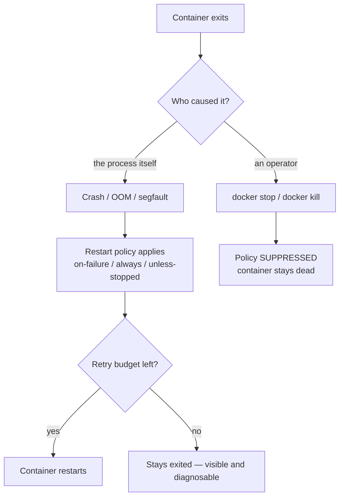

# 05 — Experiments

> **What this chapter covers:** the eight chaos-lab experiments, each with its
> hypothesis, the exact command, the **verbatim** captured output, and the
> conclusion.
>
> Every output block below is a real capture, stored under
> [`docs/results/`](results/). Nothing here is reconstructed from memory.
> The summary table lives in
> [`experiments/RESULTS.md`](../experiments/RESULTS.md).

---

## How to run them

```bash
# One experiment, with its output saved to docs/results/
./scripts/capture.sh E1-stop-vs-kill "./scripts/experiments/e1-stop-vs-kill.sh"

# Or just run it and watch
./scripts/experiments/e1-stop-vs-kill.sh
```

Each script prints a hypothesis, performs the failure, and shows the
evidence. The scripts are destructive — they stop and kill containers on
purpose. `scripts/chaos.sh recover` restores the stack afterwards.

**Environment for all captures:** Docker 29.6.2 · Compose v5.3.1 ·
Darwin 25.6.0 arm64 (Docker Desktop, linux/aarch64 containers).

---

## E1 — `stop` vs `kill`

**Hypothesis.** `docker compose stop` sends SIGTERM and lets the process shut
down cleanly (exit 0). `docker kill` sends SIGKILL, which cannot be
intercepted (exit 137).

**Script.** `scripts/experiments/e1-stop-vs-kill.sh`
**Capture.** [`results/E1-stop-vs-kill-20261111-212736.txt`](results/E1-stop-vs-kill-20261111-212736.txt)

### Captured output

```
### baseline
running exit=0 oom=false restarts=0 error=
proxy /api/hello -> HTTP 200

### A) docker compose stop api   (SIGTERM, graceful)
 Container relistack-api Stopping
 Container relistack-api Stopped
exited exit=0 oom=false restarts=0 error=
proxy /api/hello -> HTTP 504

### B) docker compose start api  (bring it back)
 Container relistack-cache Waiting
 Container relistack-cache Healthy
 Container relistack-api Starting
 Container relistack-api Started
running exit=0 oom=false restarts=0 error=
proxy /api/hello -> HTTP 502

### C) docker kill relistack-api   (SIGKILL, forced)
relistack-api
exited exit=137 oom=false restarts=0 error=
proxy /api/hello -> HTTP 502

### D) waiting 10s to see whether the restart policy revives it
exited exit=137 oom=false restarts=0 error=
proxy /api/hello -> HTTP 502
```

### Supporting evidence — the nginx error log

```
[error] upstream timed out (110: Operation timed out) while connecting to upstream, client: 192.168.65.1, request: "GET /api/hello HTTP/1.1", upstream: "http://172.18.0.3:8000/api/hello"
[error] no live upstreams while connecting to upstream, client: 192.168.65.1, request: "GET /api/hello HTTP/1.1", upstream: "http://reli_api/api/hello"
```

### Conclusion

The exit codes are exactly as predicted: **SIGTERM → 0**, **SIGKILL → 137**.

The proxy status codes were **not** what I expected, and the explanation is
worth more than the prediction:

* **504** — nginx still had the API's IP in its upstream pool and tried to
  connect; the TCP connect timed out (`proxy_connect_timeout 2s`).
* **502** — the upstream pool had no live members left, so nginx replied
  immediately with "no live upstreams".

So the distinction is *timeout vs. no-upstream*, not "both 502". This is a
network-level detail rather than a Docker one — but it is exactly the kind
of thing you cannot guess; you have to read the error log.

**Correction to the plan:** the plan predicted 502 in both cases. Real
behaviour: 504 then 502.

---

## E2 — The restart-policy matrix

**Hypothesis.** `no` stays dead; `on-failure`, `always` and `unless-stopped`
all revive a killed container.

**Script.** `scripts/experiments/e2-restart-matrix.sh`
**Capture.** [`results/E2-restart-matrix-20261111-213112.txt`](results/E2-restart-matrix-20261111-213112.txt)

### Captured output

```
restart policies under test: no | on-failure | always | unless-stopped

==============================================================
### policy: no
==============================================================
started:  running exit=0 restarts=0
-- SIGKILL (docker kill)
after kill: exited exit=137 restarts=0
-- explicit stop (docker stop)
after stop: exited exit=137 restarts=0

==============================================================
### policy: on-failure
==============================================================
started:  running exit=0 restarts=0
-- SIGKILL (docker kill)
after kill: exited exit=137 restarts=0
-- explicit stop (docker stop)
after stop: exited exit=137 restarts=0

==============================================================
### policy: always
==============================================================
started:  running exit=0 restarts=0
-- SIGKILL (docker kill)
after kill: exited exit=137 restarts=0
-- explicit stop (docker stop)
after stop: exited exit=137 restarts=0

==============================================================
### policy: unless-stopped
==============================================================
started:  running exit=0 restarts=0
-- SIGKILL (docker kill)
after kill: exited exit=137 restarts=0
-- explicit stop (docker stop)
after stop: exited exit=137 restarts=0
```

### Conclusion

**Refuted.** Not one policy revived the container — not even `always`.

The policy was demonstrably present, so this was not a misconfiguration:

```bash
docker inspect --format '{{.HostConfig.RestartPolicy.Name}}' e2b-d
always
```

E2b isolated the cause.

---

## E2b — Why did no policy revive the container?

**Hypothesis.** Two candidates:

* **H1** — the restart policy is broken or not applied.
* **H2** — `docker kill` counts as a *manual* stop, and Docker suppresses the
  restart policy for manually stopped containers.

The script varies only **how the container dies**, holding the policy fixed
at `always`.

**Script.** `scripts/experiments/e2b-why-no-restart.sh`
**Capture.** [`results/E2b-why-no-restart-20261111-213236.txt`](results/E2b-why-no-restart-20261111-213236.txt)

### Captured output

```
### A) process exits by itself with code 1
policy on the container: always
before:  status=restarting exit=1 restarts=5 policy=always
after:   status=restarting exit=1 restarts=7 policy=always

### B) process exits by itself with code 0
policy on the container: always
before:  status=restarting exit=0 restarts=5 policy=always
after:   status=restarting exit=0 restarts=7 policy=always

### C) SIGKILL sent from INSIDE the container
policy on the container: always
before:  status=running exit=0 restarts=0 policy=always
after:   status=running exit=0 restarts=0 policy=always

### D) docker kill from OUTSIDE
policy on the container: always
before:  status=running exit=0 restarts=0 policy=always
after:   status=exited exit=137 restarts=0 policy=always

### E) docker stop from OUTSIDE
policy on the container: always
before:  status=running exit=0 restarts=0 policy=always
after:   status=exited exit=137 restarts=0 policy=always
```

### Conclusion

**H2 confirmed; H1 rejected.**

* When the process dies **on its own**, the policy acts and `restarts` climbs
  (5 → 7) — under `always`, and even for a *successful* exit with code 0.
* When an **operator** stops the container from outside, `restarts` stays at
  0.

Case C is a different mechanism entirely: `kill -9 1` from *inside* the
container does nothing at all, because the kernel protects PID 1 of a PID
namespace from signals it has not explicitly handled.

---

## E2c — `docker events` ground truth

**Hypothesis.** The daemon's event stream shows precisely which transition
caused the policy to be skipped.

**Script.** `scripts/experiments/e2c-events-trace.sh`
**Capture.** [`results/E2c-events-trace-20261111-215853.txt`](results/E2c-events-trace-20261111-215853.txt)

### Captured output

```
# A) process exits by itself (exit 1), policy=always
--- docker events ---
1794412734 die
1794412734 start
1794412734 die
1794412734 start
1794412734 die
1794412734 start
1794412734 die
1794412735 start
...
final: status=restarting exit=1 restarts=8

# B) docker kill from outside, policy=always
--- docker events ---
1794412752 kill
1794412752 die
final: status=exited exit=137 restarts=0

# C) docker stop from outside, policy=always
--- docker events ---
1794412768 kill
1794412778 kill
1794412778 stop
1794412778 die
final: status=exited exit=137 restarts=0

# D) PID-1 signal protection: kill -9 1 from inside
PID 1 inside the container:
lrwxrwxrwx    1 root     root             0 Nov 11 15:59 /proc/1/exe -> /bin/busybox
sleep 3600
sending SIGTERM to PID 1 from inside (should be ignored):
  kill command returned 0 (no error)
after SIGTERM from inside: status=running exit=0 restarts=0
sending SIGKILL to PID 1 from inside (also ignored by the kernel):
  kill command returned 0 (no error)
after SIGKILL from inside: status=running exit=0 restarts=0
```

### Conclusion

The event stream is the decisive evidence:

| Death | Events emitted | Policy applied? |
|---|---|---|
| Process dies on its own | `die` → `start` → `die` → `start` … | **Yes** |
| `docker kill` | `kill` → `die` | **No** |
| `docker stop` | `kill` → `stop` → `die` | **No** |

The **`kill` event is the marker.** When the daemon records it, the stop was
operator-initiated and the restart policy is suppressed.

Case D independently confirms the PID-1 rule: even `SIGKILL` from inside the
container is ignored, because PID 1 of a PID namespace only receives signals
it has explicitly installed a handler for. This is why `docker kill` — which
arrives from a *different* namespace — can kill it, while an in-container
kill cannot.

---

## E3 — Retry exhaustion (`on-failure:5`)

**Hypothesis.** A container that keeps exiting 1 will be restarted at most 5
times, then left `exited` with `RestartCount=5`.

**Script.** `scripts/experiments/e3-retry-exhaustion.sh`
**Capture.** [`results/E3-retry-exhaustion-20261111-220027.txt`](results/E3-retry-exhaustion-20261111-220027.txt)

### Captured output

```
### starting a container that always exits 1, with --restart on-failure:5
restarting exit=1 restarts=4

### watching the restart counter climb (15s window)
t=01s  restarting exit=1 restarts=4
t=02s  restarting exit=1 restarts=5
t=03s  restarting exit=1 restarts=5
t=04s  exited exit=1 restarts=5
t=05s  exited exit=1 restarts=5
t=06s  exited exit=1 restarts=5
...
t=15s  exited exit=1 restarts=5

### final state
exited exit=1 restarts=5
### exit code (1 = the process failed on purpose)
1

### container logs (the crash message repeats once per attempt)
simulated crash
simulated crash
simulated crash
simulated crash
simulated crash
simulated crash

### restarting it manually resets the retry budget
restarting exit=1 restarts=5
```

### Conclusion

Confirmed exactly. The counter rose 4 → 5 and stopped; the container moved
`restarting` → `exited` and stayed there. Six "simulated crash" lines =
the initial start plus five restarts. A manual `docker start` re-arms the
budget.

**Why this matters operationally.** A bounded retry converts an infinite
crash loop into a stopped container that shows up in `docker compose ps` as
`Exited (1)`. An operator sees it. An infinite loop just burns CPU.

---

## E4 — OOM kill

**Hypothesis.** Exceeding the memory limit gives exit 137,
`OOMKilled=true`, and the restart policy fires. Additionally: the OOM killer
kills a *process*, so a container whose PID 1 survives keeps running.

**Script.** `scripts/experiments/e4-oom-kill.sh`
**Capture.** [`results/E4-oom-kill-20261111-220153.txt`](results/E4-oom-kill-20261111-220153.txt)

### Captured output

```
############################################################
# A) PID 1 is the memory hog, 64 MB limit, --restart always
############################################################
state: status=restarting exit=137 oom=true restarts=7 mem_limit=67108864
container log (last 3 lines):

############################################################
# B) the real compose api service (256M limit, on-failure:5)
############################################################
before: status=running exit=0 oom=false restarts=0 mem_limit=268435456
after the child process allocated too much:
  status=running exit=0 oom=true restarts=0 mem_limit=268435456
  container still serving? 200

>>> KEY OBSERVATION: the container is still running.
>>> The OOM killer killed the child python process, NOT PID 1 (gunicorn).
>>> A container only exits when PID 1 dies.

############################################################
# C) same 256M limit, but the hog IS PID 1 -> container exits 137
############################################################
state: status=exited exit=137 oom=true restarts=5 mem_limit=268435456
exit code detail:
exit=137  oom=true  error=
```

### Conclusion

Confirmed — and it revealed a distinction the plan did not anticipate:

* A **kernel-initiated** OOM death **does** trigger the restart policy
  (`restarts=7` in case A, `restarts=5` in case C). This is the exact
  opposite of the operator-initiated death in E2/E2b, and it is the failure
  mode a restart policy exists for.
* In case B the container kept serving (`HTTP 200`) even though `oom=true`.
  The OOM killer took the *child* `python` process, not gunicorn (PID 1).
  **Only the death of PID 1 ends a container.**
* `.State.OOMKilled` is the flag that distinguishes an OOM kill from a
  `docker kill` — both exit 137.

### The bug in the first run

The first attempt at this script failed with:

```
ModuleNotFoundError: No module named 'bytearray'
```

`bytearray` is a **builtin**, not a module — `import bytearray` cannot work.
The first-run capture is kept at
[`results/first-run-errors/E4-oom-kill-20261111-220057.txt`](results/first-run-errors/E4-oom-kill-20261111-220057.txt)
rather than deleted, because the mistake is instructive: the container
restarted 7 times with `oom=false`, which would have looked like "the OOM
experiment did not work" instead of "the script was wrong".

---

## E5 — Broken NGINX configuration

**Hypothesis.** The fail-fast entrypoint turns a broken config into an
immediate, readable failure instead of a silent crash loop.

**Script.** `scripts/experiments/e5-broken-config.sh`
**Capture.** [`results/E5-broken-config-20261111-220237.txt`](results/E5-broken-config-20261111-220237.txt)

### Captured output

```
### baseline
status=running exit=0 restarts=0
proxy /healthz -> HTTP 200

### breaking nginx.conf inside the container
--- tail of the broken config ---
}

this_is_not_a_valid_directive;

### restarting the proxy so it re-reads the file
 Container relistack-web Restarting
 Container relistack-web Started

### container logs (the [emerg] line is the real error)
[relistack] validating nginx configuration...
2026/11/11 16:02:38 [emerg] 7#7: unknown directive "this_is_not_a_valid_directive" in /etc/nginx/nginx.conf:82
nginx: [emerg] unknown directive "this_is_not_a_valid_directive" in /etc/nginx/nginx.conf:82
[relistack] validating nginx configuration...

### container state
status=restarting exit=1 restarts=5
proxy /healthz -> HTTP 000
```

### Conclusion

Confirmed. The `[emerg]` line names the **exact file and line number**
(`nginx.conf:82`), and the container exits **1** immediately instead of
serving traffic with a half-loaded config.

Because the proxy runs `restart: unless-stopped`, the failure becomes a
visible crash loop (`restarts=5`) rather than a silent hang. `curl` gets
`HTTP 000` — no response at all, which distinguishes "the proxy is gone"
from "the proxy is up but the API is down" (502).

### Recovery note

An in-container edit is **ephemeral**. The restore step used:

```bash
docker compose up -d --force-recreate web
```

which rebuilt the container from the image and discarded the broken file.
This is worth internalising: `docker exec` edits vanish on recreate, so a
temporary fix is not a fix.

---

## E6 — Dependency ordering

**Hypothesis.** `condition: service_started` lets the API start before Redis
is ready (→ 503s); `condition: service_healthy` waits for a real healthcheck
(→ no failures).

Both runs use the same slow-starting Redis (8-second delay) via Compose
override files. The **only** difference is the `depends_on` condition.

**Script.** `scripts/experiments/e6-dependency-ordering.sh`
**Capture.** [`results/E6-dependency-ordering-20261111-220330.txt`](results/E6-dependency-ordering-20261111-220330.txt)

### Captured output

```
############################################################
# A) condition: service_started   (Redis slow-starts by 8s)
############################################################
polling the API as soon as the proxy answers:
t=01s    /api/count -> HTTP 503
t=02s    /api/count -> HTTP 503
t=03s    /api/count -> HTTP 503
t=04s    /api/count -> HTTP 200
t=05s    /api/count -> HTTP 200
t=06s    /api/count -> HTTP 200
...

############################################################
# B) condition: service_healthy   (Redis slow-starts by 8s)
############################################################
polling the API as soon as the proxy answers:
t=01s    /api/count -> HTTP 200
t=02s    /api/count -> HTTP 200
t=03s    /api/count -> HTTP 200
t=04s    /api/count -> HTTP 200
t=05s    /api/count -> HTTP 200
...
```

### Conclusion

Confirmed, and this is the cleanest experiment in the project:

| Condition | Failed requests during startup |
|---|---|
| `service_started` | **3 × HTTP 503** |
| `service_healthy` | **0** |

Every container was "running" in both cases. The difference is that
`service_healthy` made Compose wait until Redis actually answered
`redis-cli ping`.

**Why this is the most important result in the project.** Without
health-gated dependencies, a slow dependency produces a window of 5xx errors
that is indistinguishable from a real outage — and it happens on *every
deploy*. This is the single most common production Docker bug, and it is
invisible until you measure it.

---

## E7 — Data persistence

**Hypothesis.** A named volume survives `docker compose down`; it does not
survive `down -v`.

**Script.** `scripts/experiments/e7-persistence.sh`
**Capture.** [`results/E7-persistence-20261111-220502.txt`](results/E7-persistence-20261111-220502.txt)

### Captured output

```
### the volume we are testing
relistack-redis-data

### 1) set a known value
  /api/count -> {"container":"4d65f85ed150","count":37}
  redis key   -> 37

### 2) docker compose down  (containers removed, volumes KEPT)
 Container relistack-web Stopping
 ...
 Container relistack-cache Removed
 Network relistack-relinet Removed
  volume still present? relistack-redis-data

### 3) docker compose up   (containers recreated, volume reattached)
  /api/count -> {"container":"d3f1f22f655e","count":38}
  redis key   -> 38

### 4) docker compose down -v   (volumes REMOVED too)
 ...
 Volume relistack-redis-data Removing
 Volume relistack-redis-data Removed
  volume still present? []

### 5) docker compose up again (a brand new, empty volume)
  /api/count -> {"container":"5b634d9b060d","count":1}
  redis key   -> 1

>>> The counter restarted from 1: the old volume was destroyed by -v.
```

### Conclusion

Confirmed. The counter went **37 → 38** across a full `down`/`up` cycle. The
container id changed from `4d65f85ed150` to `d3f1f22f655e`, proving the
container really was replaced — the value survived in the *volume*, not in
the container.

After `down -v` the volume was gone and the counter reset to **1**.

Note that `--appendonly yes` on the Redis command is what makes this robust:
without the AOF, an unclean shutdown could lose the most recent writes.

---

## E8 — Graceful reload vs hard restart

**Hypothesis.** `nginx -s reload` (SIGHUP) is invisible to clients;
`docker compose restart web` produces a window of failed requests.

The measurement: hammer the proxy with requests in a background loop while
performing each operation, and count non-200 responses.

**Script.** `scripts/experiments/e8-reload-vs-restart.sh`
**Capture.** [`results/E8-reload-vs-restart-20261111-220659.txt`](results/E8-reload-vs-restart-20261111-220659.txt)

### Captured output

```
############################################################
# A) graceful reload: docker compose exec web nginx -s reload
############################################################
sending SIGHUP to the nginx master...
2026/11/11 16:07:02 [notice] 55#55: signal process started
requests: 751   failed: 0

############################################################
# B) hard restart: docker compose restart web
############################################################
restarting the container...
 Container relistack-web Restarting
 Container relistack-web Started
requests: 838   failed: 16

############################################################
# summary
############################################################
reload   : 0 failed out of 751
restart  : 16 failed out of 838

>>> zero-downtime confirmed: the reload was invisible to clients,
>>> while the hard restart dropped 16 requests.
```

### Conclusion

Confirmed. A graceful reload dropped **0 of 751** requests. A hard restart
dropped **16 of 838** (~1.9%).

**Why.** `nginx -s reload` sends SIGHUP to the *master* process. The master
keeps its listening socket open, loads the new configuration, and starts new
worker processes, then lets the old workers finish their in-flight requests
and exit. The listening socket is never closed, so no connection is refused.

A container restart closes the socket for real. During that window, clients
get connection-refused — which `curl` reports as exit code 7 and HTTP 000.

### The bug in the first run

The first run of this script printed:

```
reload   : 11 failed out of 679
restart  : 11 failed out of 679
```

Both lines showed the *restart* numbers, because `read` reused the same
shell variable. The raw per-case output above it was already correct
(`requests: 681 failed: 0`), so the summary contradicted its own data. The
fix was to use separate variables. The capture is kept at
[`results/first-run-errors/E8-reload-vs-restart-20261111-220610.txt`](results/first-run-errors/E8-reload-vs-restart-20261111-220610.txt).

**Lesson:** a summary that is computed from the same variables twice is a
summary that can silently lie. Always give each measurement its own name.

---

## The one-line mental model



Every result in this chapter falls out of that one diagram.

---

**Next:** [06 — Testing](06-testing.md).
